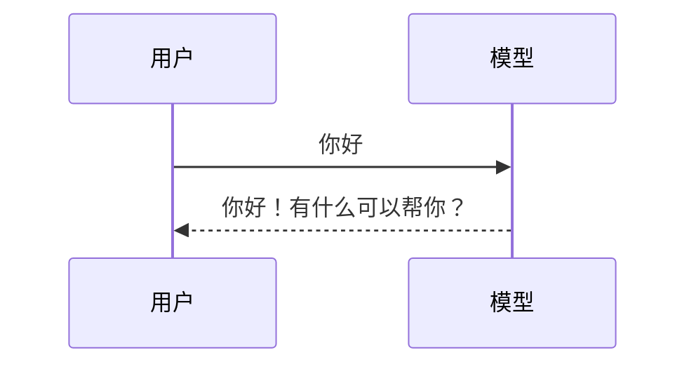
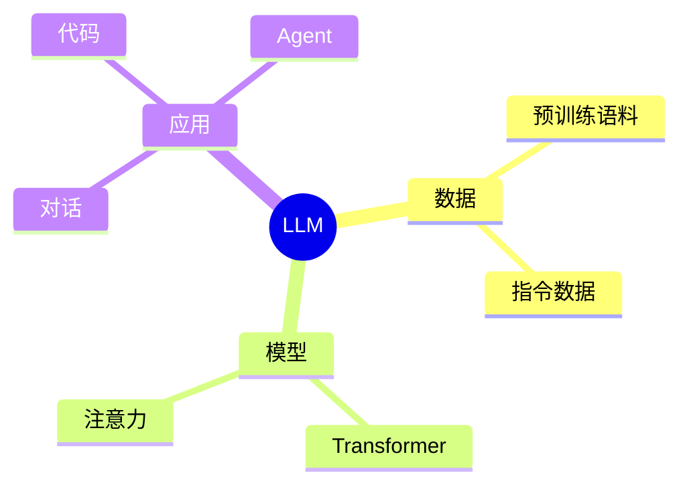

所有课程内容都是普通的 **Markdown 文件**，放在 `content/<课程ID>/` 目录下。在标准 Markdown（GFM）的基础上，本站额外支持以下组件。

## 1. 基础排版

标准 Markdown 全部可用：**加粗**、*斜体*、~~删除线~~、`行内代码`、[链接](https://github.com)、列表、表格、引用、图片，也可以直接写 HTML，例如 <mark>高亮</mark>、<kbd>Ctrl</kbd>。

- 链接到其他课节：`[第 2 节](02-tokenization.md)`，会自动转成站内跳转；跨课程用 `../课程ID/课节ID.md`
- 图片使用相对路径：``，图片放在 `content/<课程ID>/images/` 下

## 2. 数学公式（KaTeX）

````markdown
行内公式 $E = mc^2$，独立公式：

$$
\text{softmax}(z_i) = \frac{e^{z_i}}{\sum_j e^{z_j}}
$$
````

行内公式 $E = mc^2$，独立公式：

$$
\text{softmax}(z_i) = \frac{e^{z_i}}{\sum_j e^{z_j}}
$$

## 3. 提示框

````markdown
:::tip 自定义标题
内容支持 **Markdown**。
:::
````

可用类型：`note` `info` `tip` `warning` `danger` `example` `question`，标题可省略。

:::note
这是 note（省略标题）。
:::

:::tip 自定义标题
内容支持 **Markdown**。
:::

:::warning
这是 warning。
:::

:::danger
这是 danger。
:::

:::example
这是 example。
:::

## 4. 折叠块

````markdown
:::details 点击展开答案
答案是 42。
:::
````

:::details 点击展开答案
答案是 42。
:::

## 5. 选项卡

````markdown
:::tabs
@tab Python
```python
print("hello")
```
@tab JavaScript
```js
console.log("hello")
```
:::
````

:::tabs
@tab Python
```python
print("hello")
```
@tab JavaScript
```js
console.log("hello")
```
:::

## 6. 代码高亮

普通代码块写上语言名即可高亮，右上角有复制按钮。

```python
def greet(name: str) -> str:
    return f"Hello, {name}!"
```

## 7. 可运行代码

把语言写成 `js run`，读者可以直接编辑并运行：

````markdown
```js run
console.log([1, 2, 3].map(x => x * 2))
```
````

```js run
console.log([1, 2, 3].map(x => x * 2))
```

## 8. 流程图 / 时序图（Mermaid）

支持 [Mermaid](https://mermaid.js.org/) 的全部图类型：流程图、时序图、类图、状态图、甘特图、思维导图……

````markdown

````




## 9. 数据图表（Chart.js）

代码块语言写 `chart`，内容为 [Chart.js 配置](https://www.chartjs.org/docs/latest/) 的 JSON；额外支持 `height`（像素）与 `caption`（图注）。

````markdown
```chart
{
  "type": "doughnut",
  "height": 240,
  "caption": "预训练数据构成（示意）",
  "data": {
    "labels": ["网页", "书籍", "代码", "论文"],
    "datasets": [{ "data": [60, 15, 15, 10] }]
  }
}
```
````

```chart
{
  "type": "doughnut",
  "height": 240,
  "caption": "预训练数据构成（示意）",
  "data": {
    "labels": ["网页", "书籍", "代码", "论文"],
    "datasets": [{ "data": [60, 15, 15, 10], "backgroundColor": ["#4f6ef7", "#b06cf7", "#f76c9b", "#f7b267"] }]
  }
}
```

## 10. 测验

代码块语言写 `quiz`。`answer` 为正确选项的下标（从 0 开始），写成数组即为多选；可传单题对象或题目数组。

````markdown
```quiz
[
  {
    "question": "1 + 1 = ?",
    "options": ["1", "2", "3"],
    "answer": 1,
    "explain": "基础算术。"
  },
  {
    "question": "哪些是质数？",
    "options": ["2", "4", "5", "9"],
    "answer": [0, 2]
  }
]
```
````

```quiz
[
  { "question": "1 + 1 = ?", "options": ["1", "2", "3"], "answer": 1, "explain": "基础算术。" },
  { "question": "哪些是质数？", "options": ["2", "4", "5", "9"], "answer": [0, 2] }
]
```

## 11. 交互 Demo

代码块语言写 `demo 名称`，内容为该 Demo 的 JSON 配置（可留空用默认值）。名称对应 `assets/demos/<名称>.js`。

| 名称 | 用途 | 主要配置 |
| --- | --- | --- |
| `steps` | 分步讲解播放器 | `steps: [{title, body}]`，`interval` |
| `softmax` | 温度 / Top-k / Top-p 采样 | `prompt`，`candidates`，`temperature`，`controls` |
| `tokenizer` | BPE 分词实验台 | `text`，`merges`，`maxMerges` |
| `attention` | 注意力权重可视化 | `tokens`，`weights` 或 `links`，`causal`，`focus` |
| `runjs` | 可运行 JS（一般直接用 ```` ```js run ````） | `code` |

所有 Demo 都支持 `title` 字段。

````markdown
```demo steps
{
  "title": "泡一杯茶",
  "steps": [
    { "title": "烧水", "body": "把水加热到 **95°C**。" },
    { "title": "放茶叶", "body": "约 3 克。" },
    { "title": "冲泡", "body": "等待 $3$ 分钟。" }
  ]
}
```
````

```demo steps
{
  "title": "泡一杯茶",
  "steps": [
    { "title": "烧水", "body": "把水加热到 **95°C**。" },
    { "title": "放茶叶", "body": "约 3 克。" },
    { "title": "冲泡", "body": "等待 $3$ 分钟。" }
  ]
}
```

```demo softmax
{ "title": "不带输入框的精简版", "candidates": { "A": 2, "B": 1, "C": 0.5 }, "controls": ["temperature"] }
```

需要新的交互形式？参见 [如何新增一个交互 Demo](new-demo.md)。

## 12. 视频与嵌入

直接写 HTML 即可，例如嵌入 B 站 / YouTube：

```html
<iframe src="https://player.bilibili.com/player.html?bvid=XXXX" allowfullscreen></iframe>
```
