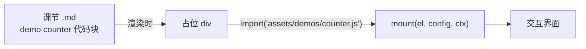

## 约定

1. 在 `assets/demos/` 下新建 `<名称>.js`（名称只能包含字母、数字、`-`、`_`）
2. 默认导出一个函数 `mount(el, config, ctx)`
3. 在 Markdown 中用 ```` ```demo <名称> ```` 引用



## 参数说明

| 参数 | 说明 |
| --- | --- |
| `el` | Demo 的容器元素，往里面写 HTML 即可 |
| `config` | Markdown 代码块中的 JSON 配置（已解析为对象） |
| `ctx.renderMarkdown(str)` | 把 Markdown（含公式）渲染为 HTML |
| `ctx.escapeHtml(str)` | 转义 HTML |
| `ctx.loadScript(src)` | 按需加载第三方脚本，例如 `assets/vendor/chart.umd.js` |
| `ctx.isDark()` | 当前是否为暗色主题 |
| 返回值 | 可选，返回一个清理函数，离开页面时调用（用于清除定时器等） |

## 最小示例

```js
// assets/demos/counter.js
export default function mount(el, config) {
  let n = config.start ?? 0;
  el.innerHTML = `<button class="btn">点我</button> <span class="val"></span>`;
  const show = () => (el.querySelector('.val').textContent = n);
  el.querySelector('button').onclick = () => { n++; show(); };
  show();
}
```

在课节中使用：

````markdown
```demo counter
{ "title": "计数器", "start": 10 }
```
````

:::tip 样式
可以直接使用站点的 CSS 变量（`--primary`、`--bg-soft`、`--border` 等）和通用类名（`.btn`、`.btn.small`、`.btn.secondary`、`.demo-row`、`.val`、`.pill`），这样 Demo 会自动适配明暗主题。
:::
