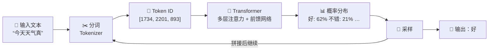

> 本课程为**示例内容**，用于演示网站的各种表现形式。正式课程内容将陆续替换。

## 一句话定义

大语言模型（Large Language Model, LLM）做的事情出奇地简单：**给定前面的文字，预测下一个 token 的概率分布**。

$$
P(x_t \mid x_1, x_2, \dots, x_{t-1})
$$

把这个过程不断重复——预测、选一个、拼回去、再预测——就得到了一段完整的回答。

:::tip 直觉
你可以把 LLM 想象成一个读过海量文本的“超级输入法联想”。区别在于，它联想的不止是下一个词，而是整个上下文的含义。
:::

## 从输入到输出



每一个方框，后面都有一节课专门讲解：

| 环节 | 做什么 | 对应课节 |
| --- | --- | --- |
| 分词 | 把文本切成 token 并映射为数字 | [第 2 节](02-tokenization.md) |
| Transformer | 让每个 token 结合上下文理解含义 | [第 3 节](03-attention.md) |
| 采样 | 从概率分布中挑出下一个 token | [第 4 节](04-sampling.md) |

## 模型越来越“大”

“大”指的是参数量。下面是几个代表性模型的参数规模（注意纵轴是对数刻度）：

```chart
{
  "type": "bar",
  "height": 280,
  "caption": "代表性模型参数量（单位：十亿，B）",
  "data": {
    "labels": ["GPT-1 (2018)", "GPT-2 (2019)", "GPT-3 (2020)", "PaLM (2022)"],
    "datasets": [{
      "label": "参数量 (B)",
      "data": [0.117, 1.5, 175, 540],
      "backgroundColor": ["#93a8ff", "#7b93ff", "#5b78f7", "#3b5bdb"],
      "borderRadius": 6
    }]
  },
  "options": {
    "scales": { "y": { "type": "logarithmic", "min": 0.05, "title": { "display": true, "text": "参数量（B，对数）" } } },
    "plugins": { "legend": { "display": false } }
  }
}
```

:::warning 参数多 ≠ 一定更好
数据质量、训练方法、对齐（alignment）同样关键。近年不少小模型在特定任务上超过了更大的老模型。
:::

## 小测验

```quiz
[
  {
    "question": "LLM 在每一步生成时，本质上输出的是什么？",
    "options": ["一整句完整的回答", "下一个 token 的概率分布", "一个固定的词", "输入文本的摘要"],
    "answer": 1,
    "explain": "模型输出的是词表上的**概率分布**，再通过采样策略选出具体的 token。"
  },
  {
    "question": "以下哪些环节属于 LLM 推理流程？",
    "options": ["分词", "Transformer 前向计算", "采样", "人工审核每个 token"],
    "answer": [0, 1, 2],
    "explain": "前三者构成了自回归生成的循环。"
  }
]
```
