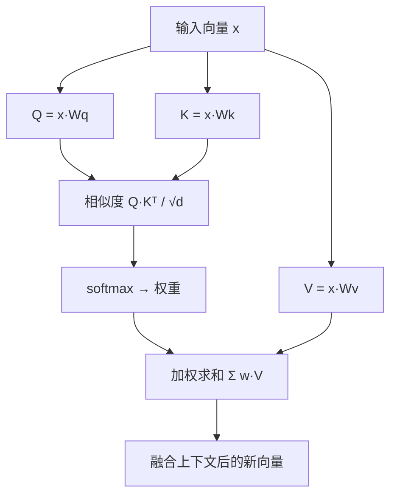
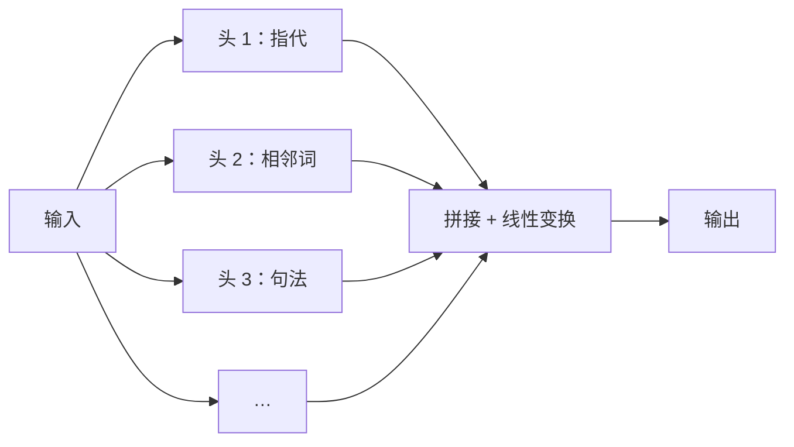

## 问题：“它”指的是谁？

> 小猫坐在垫子上，因为**它**很累。

人类一眼就知道“它”是小猫。模型要做到这一点，就需要让“它”这个位置的表示**融合**“小猫”的信息——这正是注意力机制的作用。

## Q、K、V

每个 token 会被映射成三个向量：

- **Query（查询）**：我在找什么？
- **Key（键）**：我能提供什么？
- **Value（值）**：我实际携带的信息

注意力权重由 Query 与所有 Key 的相似度决定：

$$
\text{Attention}(Q, K, V) = \text{softmax}\left(\frac{QK^\top}{\sqrt{d_k}}\right) V
$$

其中 $d_k$ 是向量维度，除以 $\sqrt{d_k}$ 是为了防止点积过大导致 softmax 过于尖锐。



## 交互：注意力在看哪里？

点击或悬停上排的词，观察它把注意力分配给了哪些词。下方矩阵的每一**行**是一个 query 的权重分布（每行之和为 100%）。

```demo attention
{
  "title": "注意力可视化",
  "tokens": ["小猫", "坐", "在", "垫子", "上", "，", "因为", "它", "很", "累"],
  "links": [["它", "小猫", 3.5], ["累", "小猫", 2.2], ["累", "它", 1.5], ["坐", "小猫", 2], ["上", "垫子", 2.5]],
  "focus": "它"
}
```

:::info 因果遮罩
GPT 类模型在生成时看不到“未来”的 token。勾选上面的「因果遮罩」，你会发现矩阵变成了下三角形。
:::

## 多头注意力

一个注意力头只能捕捉一种关系。实际模型会并行使用多个头（例如 GPT-3 每层 96 个），有的关注指代关系，有的关注相邻词，有的关注句法结构。



```quiz
{
  "question": "公式中除以 $\\sqrt{d_k}$ 的主要目的是？",
  "options": ["加快计算速度", "防止点积数值过大使 softmax 过于尖锐", "让权重之和为 1", "减少参数量"],
  "answer": 1,
  "explain": "维度越大，点积的方差越大；缩放后 softmax 的梯度更稳定。权重和为 1 是 softmax 本身保证的。"
}
```
